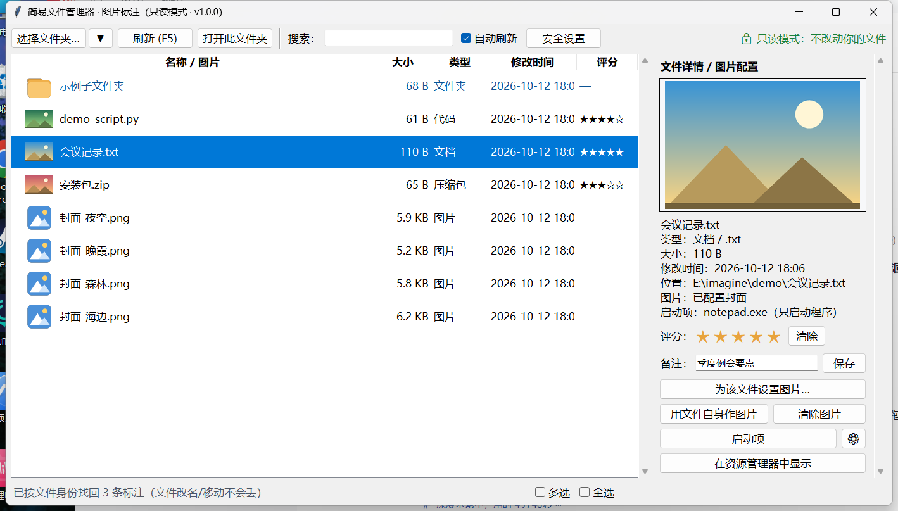

# 简易文件管理器 · 图片标注

给一个文件夹里的**每个文件**配一张图，右侧放大预览。
只管理指定的**一个文件夹**

鼠标停在"会议记录.txt"上，右侧正在预览它的图：



---
1. 双击 `简易文件管理器.exe` 运行 
2. 点左上角 **选择文件夹…**，选中想管理的那个文件夹。
3. 鼠标停在列表里任意一行 → 右侧「文件详情」里就会放大显示它的图。
4. 想给某个文件配图：选中 → 右侧 **为该文件设置图片…**。

## 平时最常用的几件事

| 想干什么 | 怎么做 |
| --- | --- |
| 给文件配一张图 | 选中它 → 右侧「为该文件设置图片…」|
| 让图片用文件自己 | 选中**图片文件** → 「用文件自身作图片」|
| 看大图 | 单击右侧那张图；再点一下或按 `Esc` 关掉 |
| 打分 / 写备注 | 右侧点星星；备注打完字按 `Enter` 或点「保存」 |
| 指定用哪个程序打开 | 右侧「启动项」→ 旁边的 ⚙ → 选一个程序；以后双击该文件就直接启动它 |
| 多选 | 最下面一行勾「多选」，或按住 `Ctrl` 单击；勾「全选」= 选中列表里全部 |
| 批量打分 | 多选之后点星星，会一次给所有选中项打上同一个分数 |
| 导出清单 | 「安全设置」→「导出」→ 选个文件夹 → 生成 `文件清单_xxx.txt` |
| 回到上次的文件夹 | 「选择文件夹…」右边的 ▼（每行后面的 ✕ 只删历史记录） |
| 在大文件夹里找东西 | 工具栏「搜索」框，边输边过滤 |
| 看文件夹有多大 | 自动统计，算好前显示「计算中…」；右键有「重新统计所有文件夹大小」 |

## 快捷键

| 键 | 作用 |
| --- | --- |
| `F5` | 刷新列表 |
| 双击 / `Enter` / `O` | 打开选中项（设了启动项就用启动项） |
| `0` – `5` | 打分（`0` = 清除评分） |
| `↑` `↓` | 上下移动 |
| `PgUp` `PgDn` | 翻页 |
| `Home` `End` | 跳到最前 / 最后 |
| `Ctrl+A` | 全选 |
| `Esc` | 关闭大图 / 关掉弹出的菜单 |
| 右键 | 菜单：配图、评分、启动项、复制完整路径、在资源管理器中显示… |

## 用户数据

在`data` 文件夹

```
data\
├─ library.json     评分 / 备注 / 启动项 / 文件身份
├─ covers\          你配置的图片【副本】（原图只被读取）
├─ cache\           缩略图、文件夹大小、文件身份的缓存
└─ config.json      上次打开的文件夹、最近列表、窗口位置
```

## 清空用户数据
**安全设置 → 开锁（🔓）→ 格式化（恢复出厂设置）**。
锁着的时候这个按钮是禁用的。

## 常见问题

**第一次运行，Windows 说"已保护你的电脑"？**
 exe 没有数字签名。点「更多信息」→「仍要运行」即可。杀毒软件偶尔也会对打包程序误报。

**JPG / WebP 的缩略图不显示？**
装一下 Pillow：双击 `安装可选依赖-Pillow.bat`。

**文件很多会不会卡？**
20,000 项：打开 0.25 秒、滚动 0.3 毫秒、搜索 20 毫秒、内存 57 MB。
列表是"窗口化"的 —— 几万项也只创建一屏多几行的行对象。

**能同时管理好几个文件夹吗？**
一次只管一个（这是刻意的），但 `data\` 里会分别记住每个文件夹的标注，来回切换都不丢。
